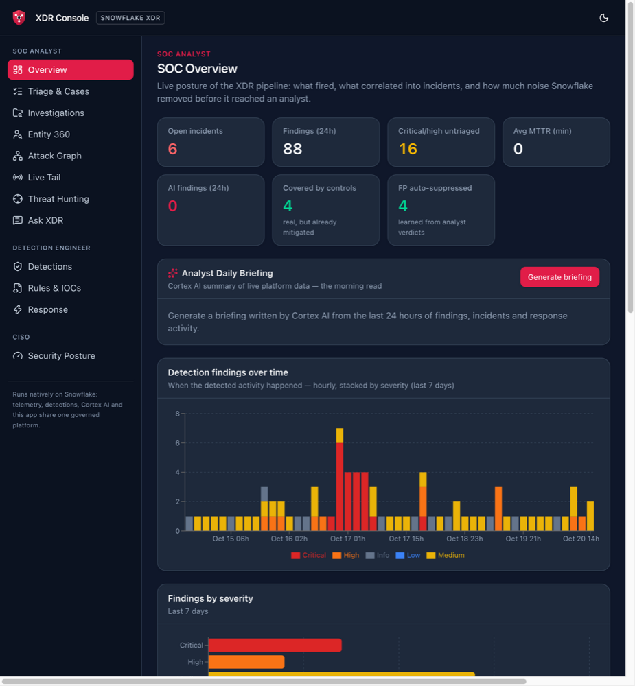
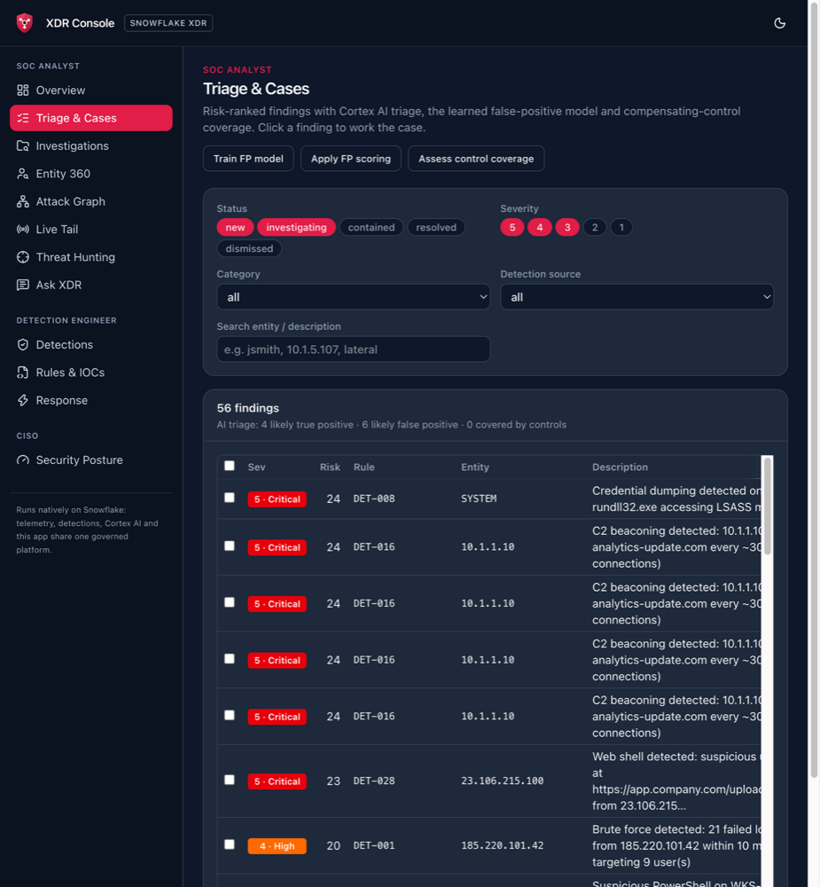
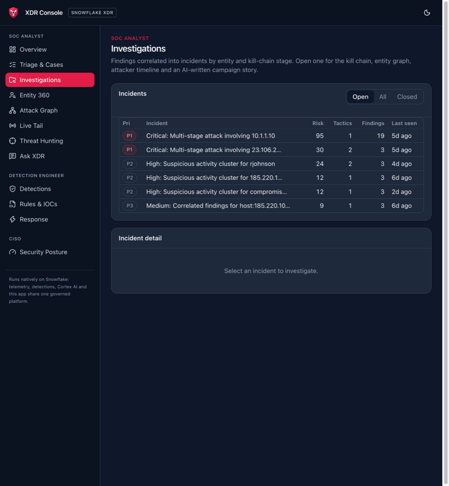
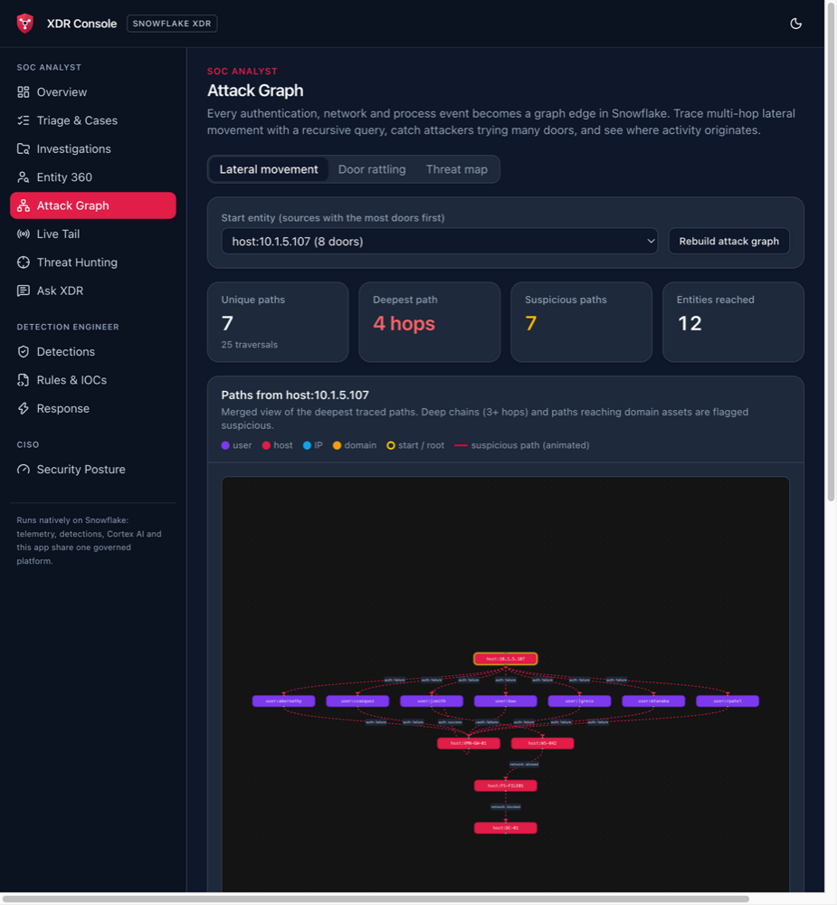
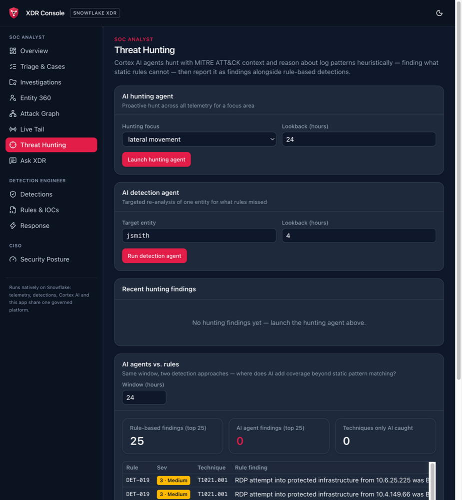
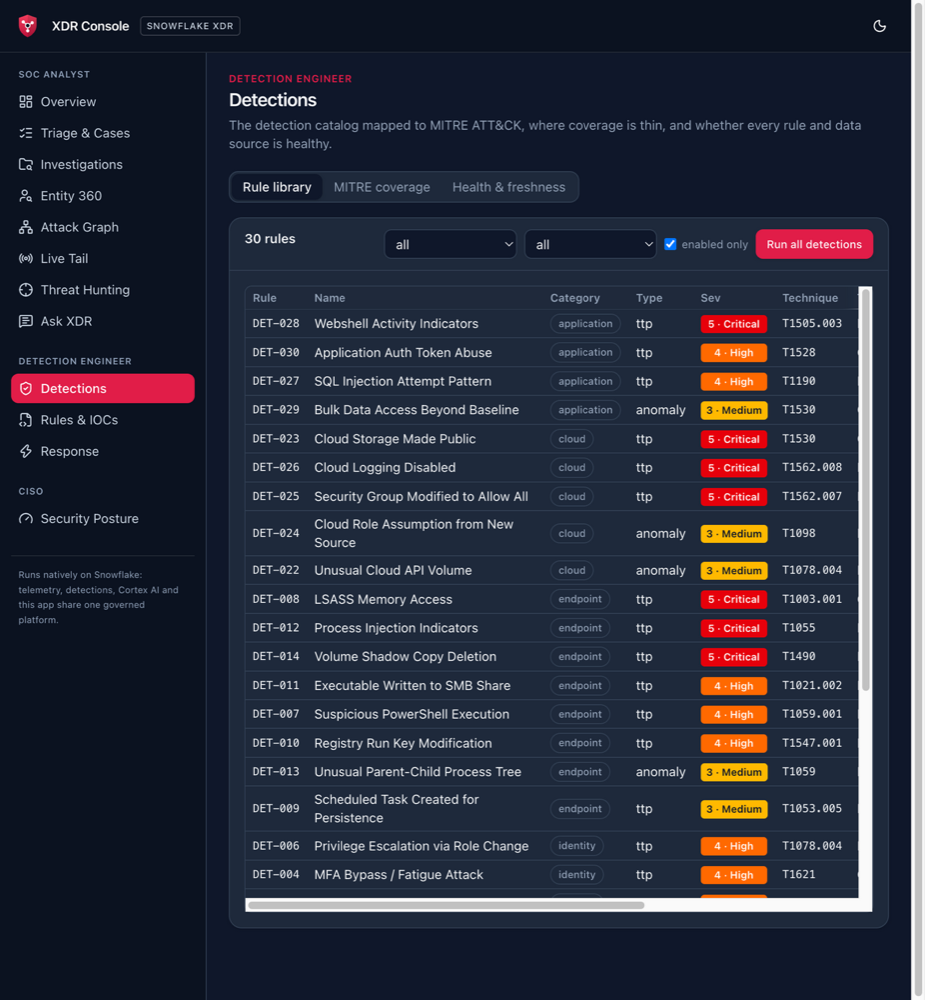
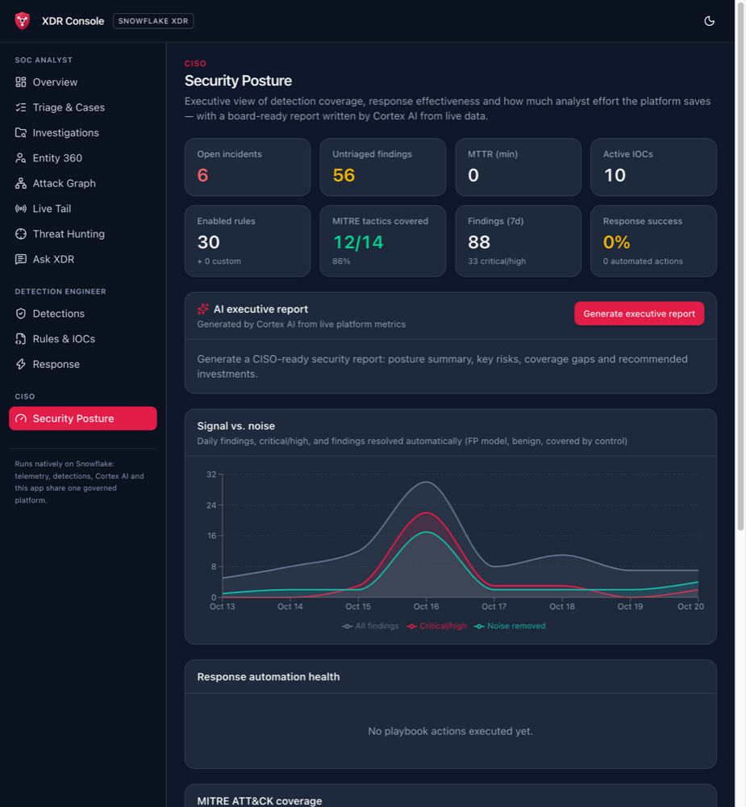

# Snowflake XDR - Security Analytics Platform

A Snowflake-native XDR/SIEM: telemetry, detections, incident correlation,
attack-graph analysis, Cortex AI agents, response automation and the analyst
UI all run inside one Snowflake account — no external infrastructure.

## Screenshots

| SOC Overview | Triage & Cases |
|---|---|
|  |  |
| **Investigations** | **Attack Graph** |
|  |  |
| **Threat Hunting** | **Detections** |
|  |  |
| **Security Posture** | |
|  | |

## What's in it

- **Detection engine** — 30 MITRE ATT&CK-mapped rules (stored procedures), custom
  rules in SQL / Python / JavaScript with an AI rule generator, ML anomaly
  detection with per-user baselines
- **Correlation** — findings grouped into incidents with kill-chain stages, entity
  graphs and attacker timelines
- **Attack graph** — every auth/network/process event becomes a graph edge; a
  recursive query traces multi-hop lateral movement and flags "door rattling"
- **Noise reduction** — an FP model learned from analyst verdicts auto-suppresses
  repeat false positives; a compensating-controls engine marks real findings that
  existing controls already mitigate (`disposition = 'mitigated_by_control'`)
- **Cortex AI** — triage, hunting, detection agents, AI_CLASSIFY categorization,
  semantic similarity, campaign stories, daily briefings, exec reports, and the
  **XDR_ANALYST Cortex Agent** (Cortex Analyst over a semantic view + Cortex Search)
- **Live tail** — streaming telemetry with realistic per-source ingestion lag
- **Response** — playbooks firing email, Slack/Teams webhooks, external API calls
- **XDR Console** — the analyst UI, a Snowflake App Runtime (Next.js) app with
  persona-grouped views for SOC analysts, detection engineers and the CISO
- **Splunk CIM compatible** — DB Connect can query `SPLUNK_VIEWS` directly

## Deploy end to end

One command builds everything on a Snowflake account (role ACCOUNTADMIN) using
the Snowflake CLI:

```bash
scripts/deploy_demo.sh                      # idempotent: safe to re-run, keeps demo state
scripts/deploy_demo.sh --fresh --yes-drop-everything   # drop and rebuild from zero (~18 min)
```

| Option | Effect |
|---|---|
| `--connection NAME` | snow CLI connection (default `aws_demo_kevin`) |
| `--fresh --yes-drop-everything` | Drop `SNOWFLAKE_XDR` and `CTF` (cases, notes, dispositions) and rebuild |
| `--skip-app` | Don't deploy the XDR Console |
| `--skip-ai` | Skip the Cortex AI triage/classification pipeline steps |
| `--legacy-streamlit` | Also redeploy the deprecated `XDR_SOC` Streamlit app (implied by `--fresh`) |
| `--with-notifications` | Evaluate playbooks — sends real email / webhook / API calls |
| `--events-per-day N` | Synthetic telemetry volume on a fresh build (default 5000) |

The runner goes through 8 phases: preflight, teardown (fresh only), schema and code (`setup/*.sql` in
order), data (CTF dataset, synthetic telemetry, the 4-stage campaign, geo seed,
demo clock), the detection → correlation → AI pipeline (on a fresh build this includes a
detection replay over the dataset's historical hot hours), the console deploy, the
legacy app, and 11 verification checks. Logs go to `output/deploy_logs/`.

Before a demo, bring the timestamps back to "now":

```bash
scripts/reset_demo_clock.sh
```

### Slack webhook secret

The webhook token is never stored in the repo. On a build that has to create
`RESPONSE.SLACK_WEBHOOK`, pass it via the environment:

```bash
SLACK_WEBHOOK_TOKEN='T000/B000/XXXX' scripts/deploy_demo.sh --fresh --yes-drop-everything
```

Otherwise a placeholder is stored; set it later with
`ALTER SECRET SNOWFLAKE_XDR.RESPONSE.SLACK_WEBHOOK SET SECRET_STRING = '<token>'`.

## UI

| App | Status | Where |
|---|---|---|
| **XDR Console** | Current | `SNOWFLAKE_XDR.DASHBOARDS.XDR_CONSOLE` (Snowflake App Runtime) — URL printed by the runner, or `cd xdr-console && snow app open` |
| XDR_SOC (Streamlit) | **Deprecated** — shows a banner linking to the console | `SNOWFLAKE_XDR.DASHBOARDS.XDR_SOC` |

Console views:

| Persona | View | Replaces (Streamlit pages) |
|---|---|---|
| SOC analyst | Overview | SOC Overview |
| | Triage & Cases | Triage Queue, Case Management |
| | Investigations | Incident View |
| | Entity 360 | Entity Investigation |
| | Attack Graph (lateral movement, door rattling, threat map) | Attack Graph, Threat Map |
| | Live Tail | Live Tail |
| | Threat Hunting | Hunting Console, Agent Comparison |
| | Ask XDR | Ask XDR |
| Detection engineer | Detections (library, MITRE coverage, health) | Detection Library, MITRE Coverage, Health Monitor |
| | Rules & IOCs | Rule Editor, IOC Manager |
| | Response (playbooks, alert center, controls) | Response Automation, Alert Center |
| CISO | Security Posture | Security Posture |

Console development: see [`xdr-console/README.md`](xdr-console/README.md).

## Splunk DB Connect Integration

The schema uses Splunk CIM field names natively. To query from Splunk:

1. Configure Splunk DB Connect with your Snowflake credentials
2. Point at `SNOWFLAKE_XDR.SPLUNK_VIEWS.V_AUTHENTICATION` (or any view)
3. Data maps directly to CIM — no field aliasing needed

```
| dbxquery query="SELECT * FROM SNOWFLAKE_XDR.SPLUNK_VIEWS.V_AUTHENTICATION WHERE action='failure' AND _time > DATEADD('hour', -1, CURRENT_TIMESTAMP())" connection="snowflake_xdr"
```

## Example: Ingesting Okta System Logs

The demo ships with synthetic data, but `RAW_LOGS.AUTHENTICATION` is CIM-shaped and already
expects `app = 'okta'` / `authentication_service = 'Okta'`. Land real Okta events there and the
existing detections, Attack Graph, Entity 360 and Splunk views pick them up unchanged.

**Recommended path (push-based, no polling code):**

```
Okta System Log ──Log Streaming──▶ Amazon EventBridge ──▶ Firehose ──▶ S3 ──Snowpipe──▶ OKTA_SYSTEM_LOG_RAW
                                                                                         │ stream + task
                                                                                         ▼
                                                                           RAW_LOGS.AUTHENTICATION ──▶ detections
```

1. In Okta Admin: **Reports → Log Streaming → Add → AWS EventBridge** (creates a partner event source).
2. In AWS: associate the event source with an event bus, add a rule targeting a Firehose
   stream that writes JSON to S3.
3. In Snowflake: create a storage integration + external stage on that bucket, then:

```sql
USE SCHEMA SNOWFLAKE_XDR.RAW_LOGS;

-- 1. Landing table + auto-ingest pipe (configure S3 event notifications to the pipe's SQS ARN)
CREATE TABLE IF NOT EXISTS OKTA_SYSTEM_LOG_RAW (
    v VARIANT, file_name STRING, loaded_at TIMESTAMP_LTZ DEFAULT CURRENT_TIMESTAMP());

CREATE PIPE IF NOT EXISTS OKTA_PIPE AUTO_INGEST = TRUE AS
  COPY INTO OKTA_SYSTEM_LOG_RAW (v, file_name)
  FROM (SELECT $1:detail, METADATA$FILENAME FROM @OKTA_STAGE)  -- EventBridge wraps the Okta event in "detail"
  FILE_FORMAT = (TYPE = JSON);

-- 2. Incrementally normalize into the CIM table the detections already read
CREATE STREAM IF NOT EXISTS OKTA_RAW_STREAM ON TABLE OKTA_SYSTEM_LOG_RAW;

CREATE TASK IF NOT EXISTS OKTA_TO_CIM
  WAREHOUSE = XDR_WH
  SCHEDULE = '1 MINUTE'
  WHEN SYSTEM$STREAM_HAS_DATA('OKTA_RAW_STREAM')
AS
INSERT INTO AUTHENTICATION
  (event_id, _time, action, app, authentication_method, authentication_service,
   dest, reason, signature, signature_id, src, user_name, user_id, user_agent,
   vendor_product, host, source, sourcetype, index_name, _raw,
   geo_city, geo_country, geo_lat, geo_lon)
SELECT
  v:uuid::STRING,
  v:published::TIMESTAMP_LTZ,
  IFF(v:outcome.result::STRING = 'SUCCESS', 'success', 'failure'),
  'okta',
  LOWER(v:authenticationContext.credentialType::STRING),
  'Okta',
  v:target[0].displayName::STRING,
  v:outcome.reason::STRING,
  v:displayMessage::STRING,
  v:eventType::STRING,
  v:client.ipAddress::STRING,
  v:actor.alternateId::STRING,
  v:actor.id::STRING,
  v:client.userAgent.rawUserAgent::STRING,
  'Okta', 'okta', 'okta:system_log', 'OktaIM2:log', 'security',
  v,
  v:client.geographicalContext.city::STRING,
  v:client.geographicalContext.country::STRING,   -- country name; map to ISO-2 if needed
  v:client.geographicalContext.geolocation.lat::FLOAT,
  v:client.geographicalContext.geolocation.lon::FLOAT
FROM OKTA_RAW_STREAM
WHERE v:eventType::STRING LIKE ANY ('user.session.%', 'user.authentication.%',
                                    'user.mfa.%', 'user.account.%');

ALTER TASK OKTA_TO_CIM RESUME;
```

Admin/policy events (`policy.*`, `group.user_membership.*`, `system.api_token.*`) fit better in
`CLOUD_API`; add a second `INSERT` for them. Validate field paths against a sample of your own events.

**Expected latency (Okta event → finding in the console):**

| Hop | Typical | Tunable |
|---|---|---|
| Okta → EventBridge (Log Streaming) | seconds | — |
| EventBridge → Firehose → S3 | 60–300 s (Firehose buffer interval) | lower the buffer interval / size |
| S3 → Snowpipe → raw table | ~30–60 s | — |
| Stream → `OKTA_TO_CIM` task | ≤ 1 min | serverless task / triggered task |
| Detections (`TASK_RUN_DETECTIONS`) | ≤ 5 min | `setup/09_scheduled_tasks.sql` |
| Incident correlation | ≤ 15 min | `setup/09_scheduled_tasks.sql` |

End to end you can expect about **2–8 minutes to a finding** and **up to about 20 minutes to a correlated incident**
with the defaults. To get findings in under 2 minutes, shorten the Firehose buffer and the detection
schedule. For faster delivery still, swap Firehose+Snowpipe for Snowpipe Streaming (a Kafka connector or SDK), which lands
events in seconds.

## Detection Coverage

| Category | Rules | MITRE Tactics |
|----------|-------|---------------|
| Identity | 6 | Credential Access, Initial Access, Privilege Escalation |
| Endpoint | 8 | Execution, Persistence, Defense Evasion, Credential Access, Impact |
| Network | 7 | Lateral Movement, C2, Exfiltration, Discovery |
| Cloud | 5 | Defense Evasion, Collection, Persistence |
| Application | 4 | Initial Access, Persistence, Collection, Credential Access |

Plus ML anomaly detection (`ML-ANOMALY-001`), door rattling (`GRAPH-RATTLE-001`),
protected-asset access (`DET-019`) and any custom rules.

Rule windows are relative to a detection clock, `DETECTIONS.DETECTION_NOW()`,
which is real time unless `REPLAY_DETECTIONS(days)` is stepping it through past
hours. That lets a freshly generated week of telemetry be detected end to end,
even though the built-in rules only look back 15–60 minutes.

## Synthetic Attack Campaigns

The generator embeds 5 scenarios — brute force chain, phishing to ransomware, cloud
privilege escalation, insider exfiltration, web application exploitation — and
`setup/17_campaign_data.sql` adds a 4-stage lateral-movement campaign:
`10.1.5.107` sprays VPN credentials → lands `jsmith` → `WS-042` → `FS-FILE01` →
`DC-01` (blocked by a firewall control), with DNS beaconing.

## Project Structure

```
snowflake-xdr/
├── scripts/
│   ├── deploy_demo.sh          # end-to-end builder (idempotent / --fresh)
│   └── reset_demo_clock.sh     # move demo timestamps to "now"
├── setup/                      # SQL, run in order by the runner
│   ├── 00_ctf_schema.sql, 00b_ctf_load.sql    # CTF dataset (data/ctf/*.csv.gz)
│   ├── 01 … 10                 # schemas, CIM log tables, detections, correlation, tasks, AI agents
│   ├── 11, 11b, 12, 13         # custom rules, response channels, API UDF, playbooks
│   ├── 14, 15                  # platform ops, semantic view, Cortex Search, ML, posture
│   ├── 16 … 21                 # attack graph, campaign data, controls, FP model, live feed, Cortex Agent
│   └── 22, 23                  # demo seed state, demo clock + dedupe
├── data/ctf/                   # compressed CTF CSVs
├── xdr-console/                # XDR Console (Snowflake App Runtime, Next.js)
├── streamlit/                  # deprecated XDR_SOC Streamlit app
└── docs/                       # demo walkthrough, story, Splunk queries
```

## Requirements

- Snowflake account with ACCOUNTADMIN
- Snowflake CLI 3.26+ (`app.yml` v2 support for the console deploy)
- Cortex AI access (COMPLETE, AI_CLASSIFY, AI_SIMILARITY, Cortex Search, Cortex Agents)
- Snowflake App Runtime enabled on the account (console); Streamlit in Snowflake (legacy app)
- Scheduled tasks are created suspended; the UI runs detections on demand
