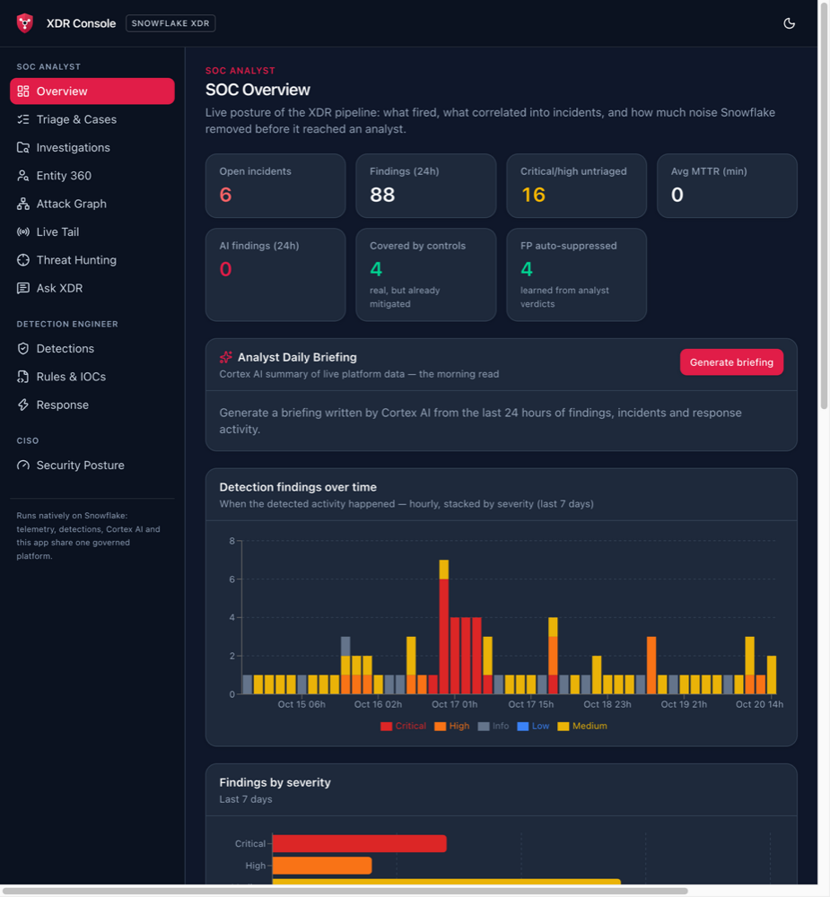
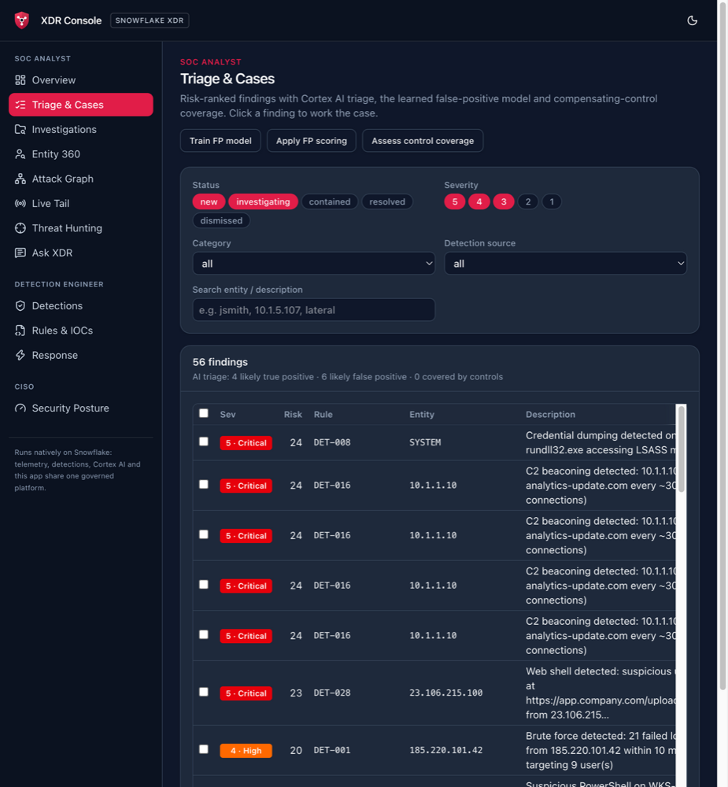
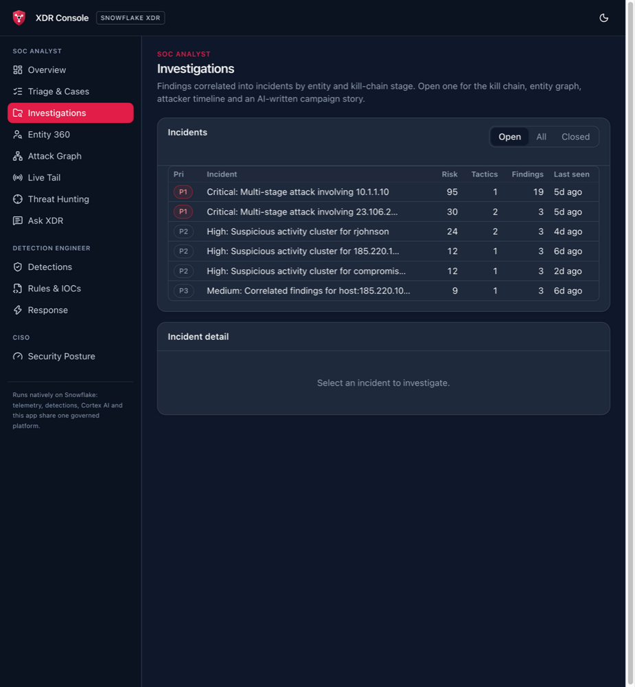
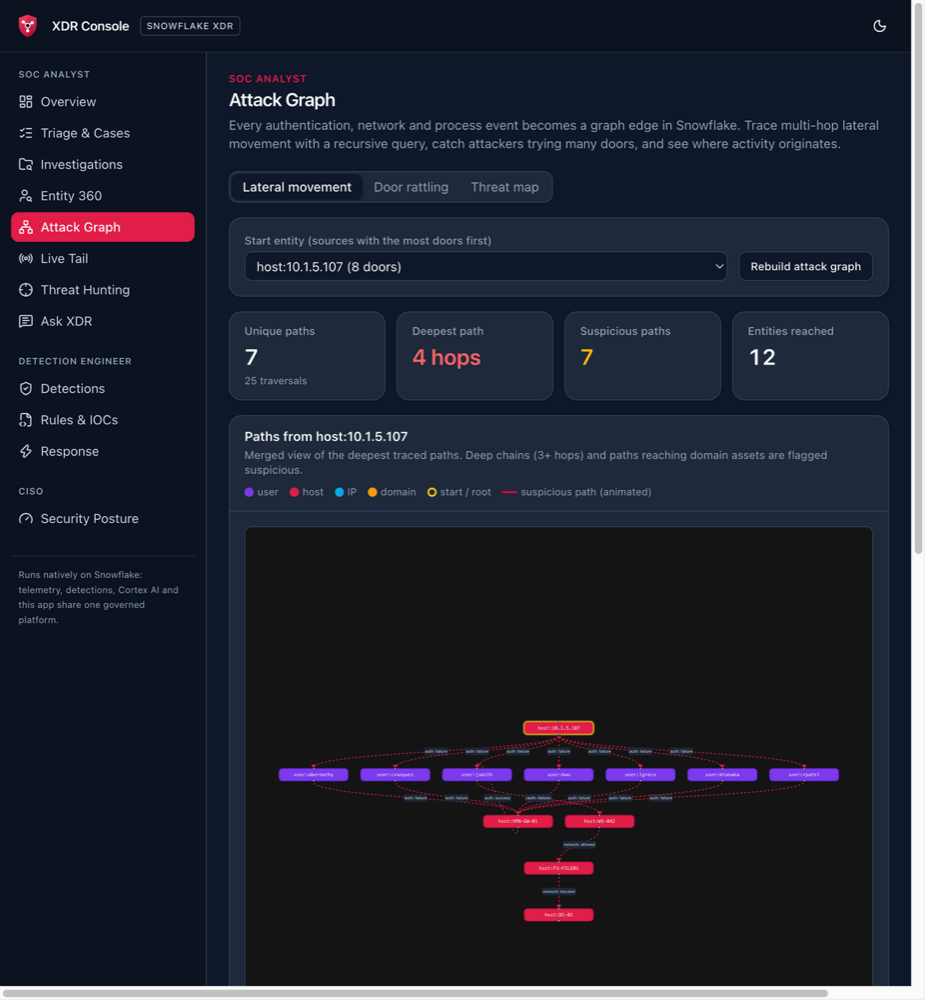
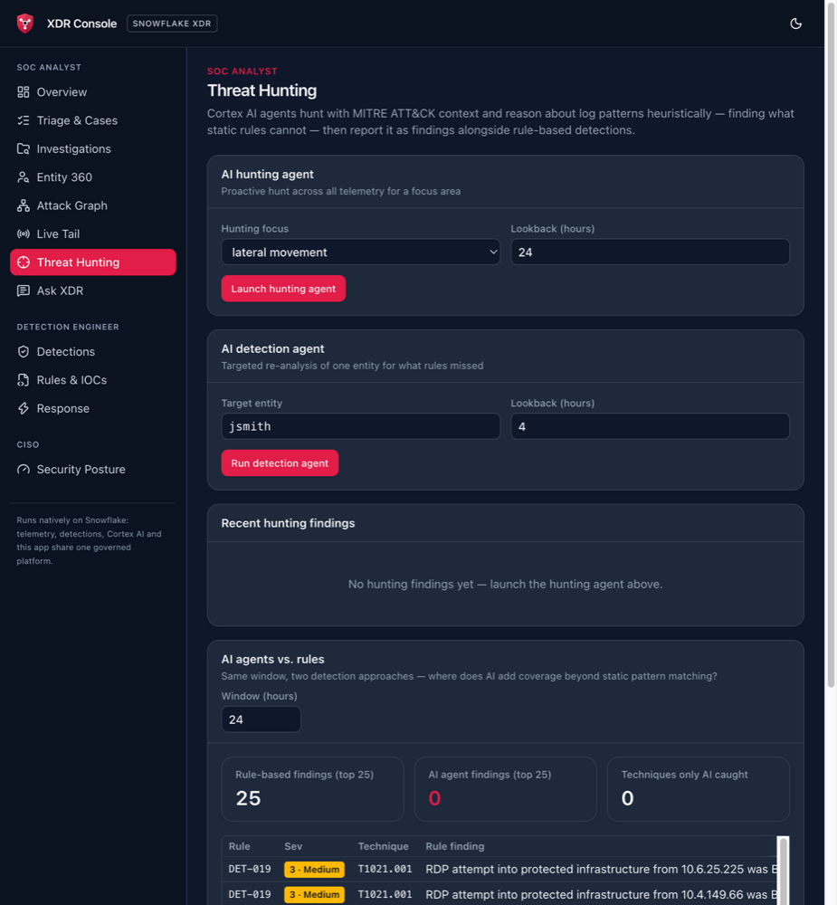
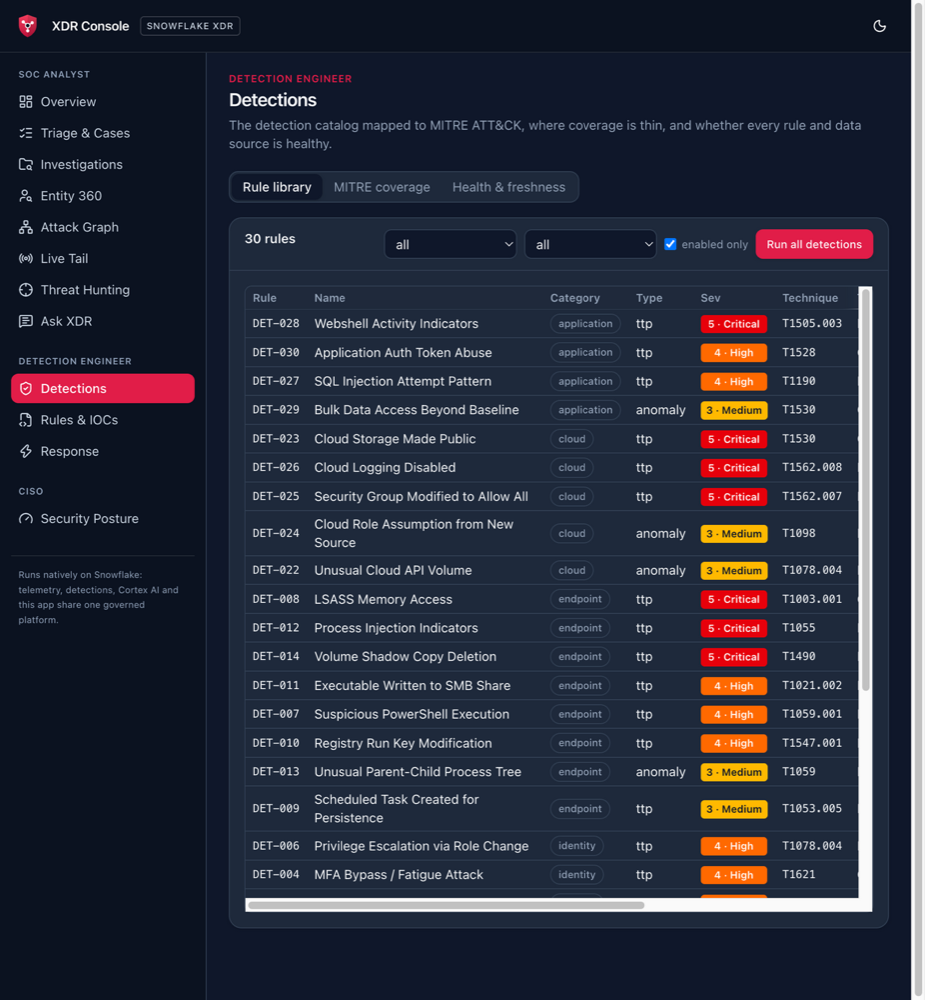
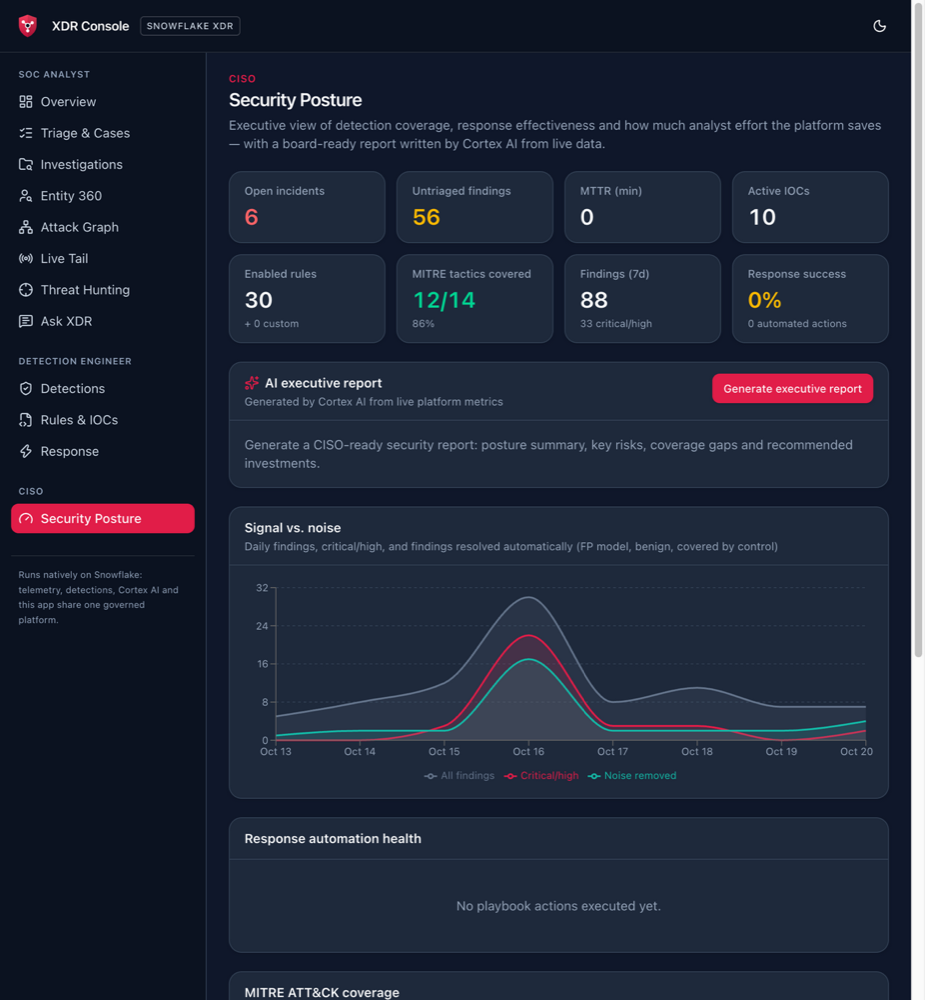
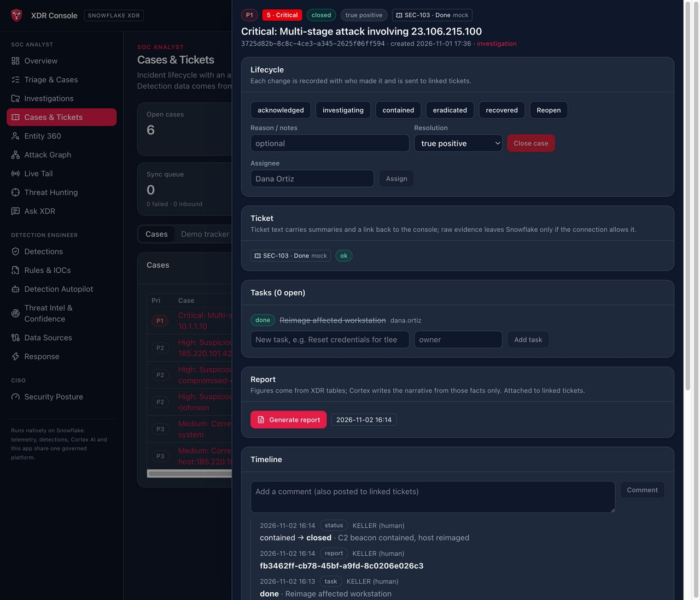
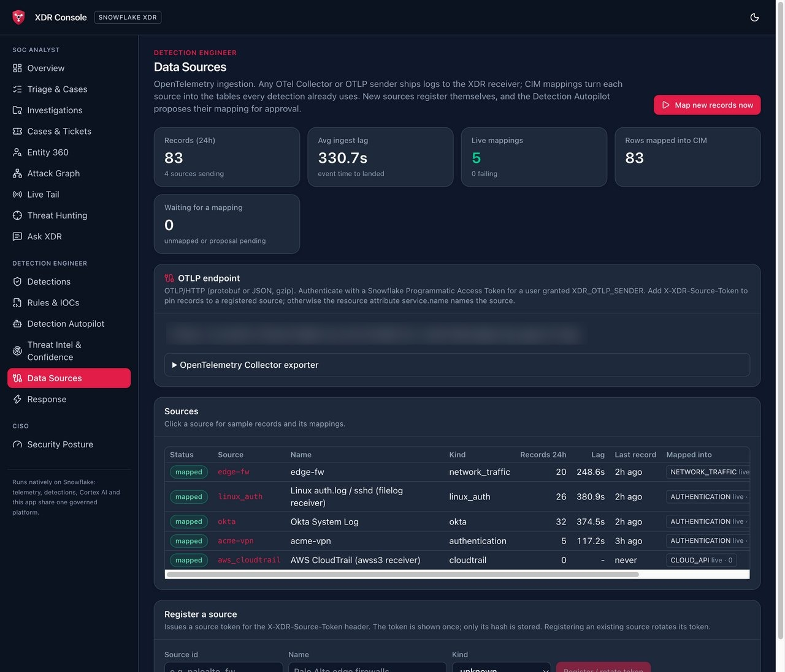

# Snowflake XDR - Security Analytics Platform

A Snowflake-native XDR/SIEM: telemetry, detections, incident correlation,
attack-graph analysis, Cortex AI agents, response automation, case management
and the analyst UI all run inside one Snowflake account. Data comes in over
standard OpenTelemetry (OTLP); incidents go out to Jira or ServiceNow.

## Screenshots

| SOC Overview | Triage & Cases |
|---|---|
|  |  |
| **Investigations** | **Attack Graph** |
|  |  |
| **Threat Hunting** | **Detections** |
|  |  |
| **Security Posture** | **Cases & Tickets** |
|  |  |
| **Data Sources (OpenTelemetry)** | |
|  | |

## What's in it

- **Detection engine** — 30 MITRE ATT&CK-mapped rules (stored procedures), custom
  rules in SQL / Python / JavaScript with an AI rule generator, ML anomaly
  detection with per-user baselines
- **Detection Autopilot** — detections that write and maintain themselves: Cortex
  drafts rules for uncovered techniques, repairs broken rules, tunes noisy ones from
  analyst verdicts, backtests every change against labelled attack data, and runs
  new rules in shadow mode before promoting them. A per-change-type policy decides
  what goes live on its own and what waits for a human (see below)
- **Correlation** — findings grouped into incidents with kill-chain stages, entity
  graphs and attacker timelines
- **Attack graph** — every auth/network/process event becomes a graph edge; a
  recursive query traces multi-hop lateral movement and flags "door rattling"
- **Noise reduction** — an FP model learned from analyst verdicts auto-suppresses
  repeat false positives; a compensating-controls engine marks real findings that
  existing controls already mitigate (`disposition = 'mitigated_by_control'`)
- **Cortex AI** — triage, hunting, detection agents, AI_CLASSIFY categorization,
  semantic similarity, campaign stories, daily briefings, exec reports, and the
  **XDR_ANALYST Cortex Agent** (Cortex Analyst over a semantic view + Cortex Search)
- **Live tail** — streaming telemetry with realistic per-source ingestion lag
- **Response** — playbooks firing email, Slack/Teams webhooks, external API calls
- **XDR Console** — the analyst UI, a Snowflake App Runtime (Next.js) app with
  persona-grouped views for SOC analysts, detection engineers and the CISO
- **OpenTelemetry ingestion** — an OTLP/HTTP receiver on Snowpark Container Services;
  any OTel Collector ships logs in, CIM mappings feed every existing detection, and
  the Detection Autopilot writes the mapping for sources it has never seen
- **Cases & tickets** — NIST-style incident lifecycle with an audit trail, response tasks,
  SLAs and Cortex-written incident reports, synced both ways with Jira or ServiceNow
- **Splunk CIM compatible** — DB Connect can query `SPLUNK_VIEWS` directly

## Deploy end to end

One command builds everything on a Snowflake account (role ACCOUNTADMIN) using
the Snowflake CLI:

```bash
scripts/deploy_demo.sh                      # idempotent: safe to re-run, keeps demo state
scripts/deploy_demo.sh --fresh --yes-drop-everything   # drop and rebuild from zero (~18 min)
```

| Option | Effect |
|---|---|
| `--connection NAME` | snow CLI connection (default `aws_demo_kevin`) |
| `--fresh --yes-drop-everything` | Drop `SNOWFLAKE_XDR` and `CTF` (cases, notes, dispositions) and rebuild |
| `--skip-app` | Don't deploy the XDR Console |
| `--skip-ai` | Skip the Cortex AI triage/classification pipeline steps |
| `--legacy-streamlit` | Also redeploy the deprecated `XDR_SOC` Streamlit app (implied by `--fresh`) |
| `--with-notifications` | Evaluate playbooks — sends real email / webhook / API calls |
| `--events-per-day N` | Synthetic telemetry volume on a fresh build (default 5000) |
| `--with-otel-receiver` | Build and deploy the OTLP receiver on Snowpark Container Services (needs Docker) |

The runner goes through 8 phases: preflight, teardown (fresh only), schema and code (`setup/*.sql` in
order), data (CTF dataset, synthetic telemetry, the 4-stage campaign, geo seed,
demo clock), the detection → correlation → AI pipeline (on a fresh build this includes a
detection replay over the dataset's historical hot hours), the console deploy, the
legacy app, and 11 verification checks. Logs go to `output/deploy_logs/`.

Before a demo, bring the timestamps back to "now":

```bash
scripts/reset_demo_clock.sh
```

### Slack webhook secret

The webhook token is never stored in the repo. On a build that has to create
`RESPONSE.SLACK_WEBHOOK`, pass it via the environment:

```bash
SLACK_WEBHOOK_TOKEN='T000/B000/XXXX' scripts/deploy_demo.sh --fresh --yes-drop-everything
```

Otherwise a placeholder is stored; set it later with
`ALTER SECRET SNOWFLAKE_XDR.RESPONSE.SLACK_WEBHOOK SET SECRET_STRING = '<token>'`.

## UI

| App | Status | Where |
|---|---|---|
| **XDR Console** | Current | `SNOWFLAKE_XDR.DASHBOARDS.XDR_CONSOLE` (Snowflake App Runtime) — URL printed by the runner, or `cd xdr-console && snow app open` |
| XDR_SOC (Streamlit) | **Deprecated** — shows a banner linking to the console | `SNOWFLAKE_XDR.DASHBOARDS.XDR_SOC` |

Console views:

| Persona | View | Replaces (Streamlit pages) |
|---|---|---|
| SOC analyst | Overview | SOC Overview |
| | Triage & Cases | Triage Queue, Case Management |
| | Investigations | Incident View |
| | Cases & Tickets (lifecycle, tasks, SLA, reports, Jira/ServiceNow sync, demo tracker) | new |
| | Entity 360 | Entity Investigation |
| | Attack Graph (lateral movement, door rattling, threat map) | Attack Graph, Threat Map |
| | Live Tail | Live Tail |
| | Threat Hunting | Hunting Console, Agent Comparison |
| | Ask XDR | Ask XDR |
| Detection engineer | Detections (library, MITRE coverage, health) | Detection Library, MITRE Coverage, Health Monitor |
| | Rules & IOCs | Rule Editor, IOC Manager |
| | Detection Autopilot (change feed, approvals, autonomy policy) | new |
| | Threat Intel & Confidence (spot checks, calibration, indicators, feeds, ATT&CK/KEV/Sigma) | new |
| | Data Sources (OTLP endpoint, source health, CIM mappings, source tokens) | new |
| | Response (playbooks, alert center, controls) | Response Automation, Alert Center |
| CISO | Security Posture | Security Posture |

Console development: see [`xdr-console/README.md`](xdr-console/README.md).

## Detection Autopilot

The biggest cost of running detections on a data platform is writing and maintaining
the detection logic. The Detection Autopilot (`setup/26_autopilot.sql`) runs that
loop itself and keeps a human in charge of how far it may go.

```
assess ──► propose ──► validate ──► decide (policy) ──► shadow ──► promote
  │                                    │                            │
  │  MITRE gaps, broken rules,         ├─ auto_live: apply now      └─ guardrail: auto-rollback
  │  analyst FP verdicts, noisy /      ├─ propose_only: wait for a human    on errors or floods
  │  silent rules                      └─ off
```

| Step | How |
|---|---|
| Assess | Uncovered techniques from `REFERENCE.AUTOPILOT_TECHNIQUE_BACKLOG`, rules erroring in `CUSTOM_RULE_ERRORS`, rules with repeated `false_positive` verdicts, very loud rules, rules silent for 30 days |
| Propose | Cortex (`claude-sonnet-4-5`) writes or rewrites the rule SQL; threshold tunes are deterministic |
| Validate | Shared SQL guard (`DASHBOARDS.RULE_SQL_VIOLATION`: one read-only SELECT on `RAW_LOGS` only), execution, then a 7-day backtest against `REFERENCE.V_ATTACK_GROUND_TRUTH` (labelled campaign events): recall, matches, benign matches, matches on analyst-FP entities |
| Self-correct | A shadow rule that misses labelled attacks is rewritten with the missed raw events as feedback (2 revisions max, kept only if recall improves); if it still fails it is retired as `failed` and the technique is retried later |
| Shadow | `CUSTOM_RULES.test_mode = TRUE`: the rule runs on schedule but writes to `DETECTIONS.SHADOW_FINDINGS`, never to analysts |
| Promote | Once a shadow rule is old enough and meets the policy's recall / benign limits |
| Guardrail | A live autopilot change that errors, or produces more than 200 findings a day, is reverted from rule history |
| Notify | `AUTOPILOT_CHANGES` feed (console + agent), Slack webhook on promotions / rollbacks / new proposals, daily email digest |

**Autonomy policy** (`DETECTIONS.AUTOPILOT_POLICY`, editable in the console, by SQL or by asking the agent):

| Change type | Default mode | Notes |
|---|---|---|
| `new_rule` | shadow_then_promote | 24h in shadow, recall ≥ 0.5, ≤ 10 benign matches |
| `fix_broken` | shadow_then_promote | 6h in shadow |
| `tune_filter` | shadow_then_promote | must reduce matches on FP entities without losing recall |
| `tune_threshold` | auto_live | deterministic, reversible |
| `disable_noisy` | propose_only | always a human for built-in rules and severity 4-5 |
| `retire_silent` | propose_only | |
| `new_parser` | propose_only | reserved for the OTel ingestion phase |

Hard limits that no policy can lift: the autopilot never deletes data or rules, never
edits a pinned rule, never auto-disables a built-in or severity 4-5 rule, and every
change is versioned in `CUSTOM_RULE_HISTORY` so rollback is one click.

Human in the loop:

- **Console → Detection Autopilot** — KPIs, change feed, and for each change the
  rationale, backtest, self-correction log, before/after SQL and shadow findings, with
  Approve / Reject / Roll back / Pin. Decisions record the signed-in user.
- **Ask XDR** — "What did the Detection Autopilot change this week?", "Approve the T1005
  rule", "Require approval for new rules", "Run the autopilot now".
- **SQL** — `CALL DETECTIONS.AUTOPILOT_CYCLE()`, `AUTOPILOT_DECIDE(change_id, 'approve'|'reject'|'rollback', note)`,
  `AUTOPILOT_SET_POLICY(change_type, mode)`, `AUTOPILOT_STATUS(days)`, `AUTOPILOT_DIGEST()`.

Scheduling: `TASK_AUTOPILOT` (every 6 hours) and `TASK_AUTOPILOT_DIGEST` (07:00 UTC) are
created suspended; resume them to let the autopilot run unattended. The digest goes to
`AUTOPILOT_SETTINGS.digest_email`, or to the email of the user running it.
`setup/27_autopilot_demo.sql` resets the autopilot and runs two real cycles so the
console opens with a genuine change history (the runner does this automatically).

The same engine maps new log sources into the CIM (`new_parser`, see
[OpenTelemetry ingestion](#opentelemetry-ingestion); design notes in
[`docs/otel_ingestion_plan.md`](docs/otel_ingestion_plan.md)).

## Threat intel that stays current, and false positives without blind spots

`setup/28_threat_intel.sql` and `setup/29_confidence.sql`; console: **Detection Engineer →
Threat Intel & Confidence**, plus confidence badges in Triage.

**Feeds** (`REFERENCE.SYNC_THREAT_INTEL`, daily task `TASK_SYNC_THREAT_INTEL`, External Access
Integration `XDR_INTEL_EAI`):

| Feed | What it gives the XDR |
|---|---|
| abuse.ch Feodo Tracker | live botnet C2 IPs (ThreatFox and URLhaus too once `REFERENCE.ABUSE_CH_AUTH_KEY` holds a free abuse.ch key) |
| MISP warninglists | ~120k known-benign entries (public DNS, cloud/CDN ranges, top sites, known TI false positives) |
| MITRE ATT&CK (STIX) | full Enterprise catalog in `REFERENCE.ATTACK_CATALOG`, new / changed techniques flagged |
| CISA KEV | `REFERENCE.KEV_CATALOG`, new exploited vulnerabilities in the digest |
| SigmaHQ core | 1,377 community rules in `REFERENCE.SIGMA_RULES`, mapped to our log tables |

Sigma techniques we have telemetry for but no rule join the autopilot backlog, and the
autopilot's authoring prompt gets the Sigma logic as a reference to translate, including its
known false positives. Every resulting rule still goes through backtest → shadow → promote.

**Indicator confidence** (`REFERENCE.SCORE_IOCS`): feed confidence × source reliability × age
decay (half-life 14 days for IPs, 45 for domains, 7 for URLs, a year for hashes) + corroboration
across sources + analyst feedback on the findings it produced. Indicators on a hard warninglist
(for example 8.8.8.8 from an OSINT paste), expired, or below 25 do not alert; shared cloud space
only lowers confidence, because attackers host C2 there too. Analysts can pin, revoke, restore
or allowlist any indicator.

**Finding confidence** (`DETECTIONS.SCORE_CONFIDENCE`): every finding gets `conf_score` (0-1),
`conf_band` (high ≥ 0.7, low < 0.35) and `conf_factors`, a log-odds explanation:

| Factor | Source |
|---|---|
| rule precision | Beta posterior over human verdicts; prior from the autopilot backtest or the rule's stated confidence, shrunk toward 50% |
| entity history | human verdicts for this rule on this entity |
| corroborated | other rules firing on the same entity within 24h |
| incident | finding is part of a correlated incident |
| IOC confidence | effective confidence of the matched indicator |
| AI second opinion | AI_CLASSIFY false-positive probability |

Triage sorts by severity × confidence and can filter by band.

**Human in the loop, and why automation cannot hide attacks:**

- *Verdict provenance.* `disposition_source` records who decided (analyst, review, fp_model,
  suppression, control, confidence_model). Only human verdicts train the FP model, so
  suppression can no longer teach itself to suppress more (the previous behaviour).
- *Auto-suppression is narrow.* Only low-confidence findings with a learned human FP pattern
  and no corroboration (policy `auto_suppress`).
- *Safety net.* A machine-dismissed finding that another detection corroborates, or that turns
  high confidence, is re-opened automatically.
- *Spot checks.* `SAMPLE_REVIEWS` queues at least one finding per suppression pattern per week
  plus a 10% sample. A "real attack" verdict revokes the suppression, re-opens everything it
  hid, retrains the model and logs a `revoke_suppression` change.
- *Proposals, not silent changes.* The autopilot proposes `suppress_entity` (expiring, 30 days),
  `intel_allowlist`, and `recheck_verdicts` when analysts dismissed findings that other
  detections now contradict. Re-checks always need a human, and a rule whose findings are
  corroborated is never proposed for disabling.
- *Measured.* `V_CONFIDENCE_CALIBRATION` (how often each band was confirmed) and
  `V_SUPPRESSION_QUALITY` (miss rate and estimated hidden true positives per dismissal path).

Demo story (reset by `setup/27_autopilot_demo.sql`): analysts have dismissed DET-021 on both a
scheduled vulnerability scanner and the real C2 beacon from 10.1.1.10. The confidence model
keeps the scanner suppressed (uncorroborated, spot-checked) but re-opens the machine-suppressed
C2 findings because DET-016 beaconing corroborates them, and the autopilot asks a human to
re-check the 13 earlier verdicts. Ask XDR: "Is automation hiding any real attacks?"

## OpenTelemetry ingestion

Out-of-the-box ingestion for any source an OpenTelemetry Collector can read
(files, syslog, cloud audit logs, Kubernetes, ...). The XDR speaks plain OTLP, so
there is no XDR agent or vendor SDK to install.

```
OTel Collector / OTLP SDK ──OTLP/HTTP + PAT──▶ XDR_OTLP_RECEIVER (SPCS) ──▶ RAW_LOGS.OTEL_LOGS
                                                                                │ CIM mappings (1-min task)
                                                                                ▼
                     AUTHENTICATION · CLOUD_API · NETWORK_TRAFFIC · ... ──▶ every built-in + custom rule
```

| Piece | Where |
|---|---|
| Receiver: FastAPI on Snowpark Container Services, public endpoint `/v1/logs`, protobuf or JSON, gzip; 503 = retry | `otel-receiver/`, `setup/31_otel_receiver.sql`, `scripts/deploy_otel_receiver.sh` |
| Landing table, source registry + tokens, `INGEST_OTLP_LOGS` (owner's rights: the service role can only call this) | `setup/30_otel_ingest.sql` |
| Mapping engine: one SELECT per source → CIM table, incremental by watermark, rows tagged `index_name='otel'`, `source='otel:<id>'` for exact rollback | `APPLY_CIM_MAPPINGS`, `ACTIVATE_CIM_MAPPING`, `RETIRE_CIM_MAPPING` |
| Shipped mappings | `okta` (System Log `user.session.*`), `linux_auth` (sshd), `aws_cloudtrail` |
| Collector examples | `otel-receiver/collector-examples/` (Linux auth.log, CloudTrail from S3, Okta System Log forwarder) |

**Deploy and send:**

```bash
scripts/deploy_otel_receiver.sh             # prints https://<ingress>.snowflakecomputing.app/v1/logs
# a sender identity: service user + PAT restricted to XDR_OTLP_SENDER
#   CREATE USER XDR_OTEL_COLLECTOR TYPE = SERVICE; GRANT ROLE XDR_OTLP_SENDER TO USER XDR_OTEL_COLLECTOR;
#   ALTER USER XDR_OTEL_COLLECTOR ADD PROGRAMMATIC ACCESS TOKEN collector ROLE_RESTRICTION = 'XDR_OTLP_SENDER';
python3 scripts/otel_replay.py --endpoint https://<ingress>/v1/logs --pat-file pat.txt   # demo attack stories
```

Collector exporter:

```yaml
exporters:
  otlphttp/xdr:
    logs_endpoint: https://<ingress>.snowflakecomputing.app/v1/logs
    compression: gzip
    headers:
      Authorization: Snowflake Token="${env:XDR_PAT}"
      X-XDR-Source-Token: ${env:XDR_SOURCE_TOKEN}   # optional, from Data Sources > Register a source
```

The ingress authenticates every request with Snowflake (a PAT for a user granted
`XDR_OTLP_SENDER`; PATs need a network policy unless the user's authentication
policy relaxes that). Without a source token, the resource attribute `service.name`
names the source.

**New sources map themselves.** A source XDR has never seen registers as
`unmapped`. The next Detection Autopilot cycle (`new_parser`) reads sample records,
has Cortex write the mapping SELECT and the target CIM table, and validates it:

- it may only read `OTEL_LOGS`;
- every column must exist in the target table;
- the required fields (time, action, user / src / dest) must be at least 95% filled.

The policy defaults to `propose_only`. Approving the proposal (in Data Sources,
Detection Autopilot or Ask XDR) puts the mapping live and backfills everything
already received. Rollback retires the mapping and deletes exactly the rows it
produced.

In the demo, an unknown key=value VPN log and a JSON firewall log were each mapped
correctly on the first attempt, into AUTHENTICATION and NETWORK_TRAFFIC. DET-001
then fired on the Okta and sshd brute-force stories without any rule changes.

`deploy_demo.sh` seeds the same three stories through `INGEST_OTLP_LOGS`
(`SEED_OTEL_DEMO`), so the demo works without the container.

## Cases, tickets and incident reports

`setup/32_incident_tracking.sql` and `setup/33_ticketing.sql`; console: **SOC Analyst → Cases & Tickets**.
Design: [`docs/incident_integration_plan.md`](docs/incident_integration_plan.md).

**Native case management.**

- **Lifecycle:** `open → acknowledged → investigating → contained → eradicated → recovered → closed`.
  Closing requires a resolution (`true_positive`, `benign`, `false_positive`, `duplicate`, `test`).
- **Audit trail:** every change goes through `SET_INCIDENT_STATE`, `ASSIGN_INCIDENT`,
  `ADD_INCIDENT_COMMENT` or `UPSERT_INCIDENT_TASK`, and lands in `INCIDENT_EVENTS` with the actor and
  whether it was a human, the agent, the autopilot, a ticket system or the platform.
- **SLAs:** acknowledge / contain / resolve targets per priority (`INCIDENT_SLA_POLICY`). Breaches
  become events.
- **Metrics:** `V_INCIDENT_METRICS` gives MTTA, MTTC and MTTR, SLA compliance and reopen rate.
- **Incident report:** `GENERATE_INCIDENT_REPORT` writes Markdown with:
  - executive summary;
  - response times against SLA;
  - what happened;
  - kill chain, scope and evidence;
  - response actions and the case timeline;
  - root cause, lessons learned and detection gaps.

  Every figure comes from SQL; Cortex only drafts the narrative from those facts.

**Ticket sync** (`SYNC_TICKETS`, task `TASK_TICKET_SYNC`, every 2 minutes, created suspended):

| Step | What happens |
|---|---|
| Route | Open incidents at or above a connection's priority (default P2) get a ticket, unless every finding in them was dismissed or is low confidence (phase 1.5 FP control keeps ticket noise down). A retry looks for the XDR reference first, so it never opens a duplicate. |
| Push | `INCIDENT_OUTBOX`: create, comment, transition, attach report. Uses backoff, honours `Retry-After`, and records failures on the case. |
| Poll / webhook | Remote state, assignee and comments land in `TICKET_INBOX`, deduplicated. Push uses `POST /v1/webhooks/{connection}` on the OTLP receiver (Snowflake PAT, optional HMAC `X-Hub-Signature`). |
| Apply | Changes go through the lifecycle with actor type `ticket`. They are audited and never echoed back. New findings on a closed incident reopen it. |

**Connectors:**

- **Jira Cloud** (REST v3):
  - ADF descriptions, labels `xdr-<incident_id>`;
  - transitions discovered per workflow;
  - report attachments.
- **ServiceNow** (Table API):
  - Security Incident Response `sn_si_incident`, or ITSM `incident`;
  - `correlation_id` reference, priority via urgency/impact;
  - states read from the instance's own `sys_choice`;
  - close codes and work notes.
- **mock:** a Jira-style tracker kept in Snowflake, so the round trip demos without credentials. In
  the console's Demo tracker tab you play the Jira analyst.

**Ownership and data rules.** Once a ticket exists, its workflow state is authoritative. XDR
detection data is authoritative in the other direction. Only summaries and a console link leave
Snowflake, unless a connection sets `include_raw_evidence`.

Connect a real Jira:

```sql
ALTER SECRET SNOWFLAKE_XDR.INCIDENTS.JIRA_CREDENTIALS SET USERNAME = 'you@acme.com' PASSWORD = '<API token>';
CALL SNOWFLAKE_XDR.INCIDENTS.CONFIGURE_TICKET_CONNECTION('jira', 'https://acme.atlassian.net', TRUE,
     PARSE_JSON('{"project_key": "SEC"}'));   -- also allows egress to exactly that host
```

ServiceNow is the same, using `SERVICENOW_CREDENTIALS` and connection `servicenow`. The
integration user needs `sn_si.integration_user` for SIR.

The Jira and ServiceNow connectors follow the documented REST APIs but have not been run against
a live site from this repo yet. The mock and webhook paths are tested end to end.

Ask XDR can work cases too (tools `case_action`, `ticketing_status`): "comment on this incident,
open a ticket and give me the key".

## Splunk DB Connect Integration

The schema uses Splunk CIM field names natively. To query from Splunk:

1. Configure Splunk DB Connect with your Snowflake credentials
2. Point at `SNOWFLAKE_XDR.SPLUNK_VIEWS.V_AUTHENTICATION` (or any view)
3. Data maps directly to CIM — no field aliasing needed

```
| dbxquery query="SELECT * FROM SNOWFLAKE_XDR.SPLUNK_VIEWS.V_AUTHENTICATION WHERE action='failure' AND _time > DATEADD('hour', -1, CURRENT_TIMESTAMP())" connection="snowflake_xdr"
```

## Example: Ingesting Okta System Logs

The demo ships with synthetic data, but `RAW_LOGS.AUTHENTICATION` is CIM-shaped and already
expects `app = 'okta'` / `authentication_service = 'Okta'`. Land real Okta events there and the
existing detections, Attack Graph, Entity 360 and Splunk views pick them up unchanged.

**Recommended path (push-based, no polling code):**

```
Okta System Log ──Log Streaming──▶ Amazon EventBridge ──▶ Firehose ──▶ S3 ──Snowpipe──▶ OKTA_SYSTEM_LOG_RAW
                                                                                         │ stream + task
                                                                                         ▼
                                                                           RAW_LOGS.AUTHENTICATION ──▶ detections
```

1. In Okta Admin: **Reports → Log Streaming → Add → AWS EventBridge** (creates a partner event source).
2. In AWS: associate the event source with an event bus, add a rule targeting a Firehose
   stream that writes JSON to S3.
3. In Snowflake: create a storage integration + external stage on that bucket, then:

```sql
USE SCHEMA SNOWFLAKE_XDR.RAW_LOGS;

-- 1. Landing table + auto-ingest pipe (configure S3 event notifications to the pipe's SQS ARN)
CREATE TABLE IF NOT EXISTS OKTA_SYSTEM_LOG_RAW (
    v VARIANT, file_name STRING, loaded_at TIMESTAMP_LTZ DEFAULT CURRENT_TIMESTAMP());

CREATE PIPE IF NOT EXISTS OKTA_PIPE AUTO_INGEST = TRUE AS
  COPY INTO OKTA_SYSTEM_LOG_RAW (v, file_name)
  FROM (SELECT $1:detail, METADATA$FILENAME FROM @OKTA_STAGE)  -- EventBridge wraps the Okta event in "detail"
  FILE_FORMAT = (TYPE = JSON);

-- 2. Incrementally normalize into the CIM table the detections already read
CREATE STREAM IF NOT EXISTS OKTA_RAW_STREAM ON TABLE OKTA_SYSTEM_LOG_RAW;

CREATE TASK IF NOT EXISTS OKTA_TO_CIM
  WAREHOUSE = XDR_WH
  SCHEDULE = '1 MINUTE'
  WHEN SYSTEM$STREAM_HAS_DATA('OKTA_RAW_STREAM')
AS
INSERT INTO AUTHENTICATION
  (event_id, _time, action, app, authentication_method, authentication_service,
   dest, reason, signature, signature_id, src, user_name, user_id, user_agent,
   vendor_product, host, source, sourcetype, index_name, _raw,
   geo_city, geo_country, geo_lat, geo_lon)
SELECT
  v:uuid::STRING,
  v:published::TIMESTAMP_LTZ,
  IFF(v:outcome.result::STRING = 'SUCCESS', 'success', 'failure'),
  'okta',
  LOWER(v:authenticationContext.credentialType::STRING),
  'Okta',
  v:target[0].displayName::STRING,
  v:outcome.reason::STRING,
  v:displayMessage::STRING,
  v:eventType::STRING,
  v:client.ipAddress::STRING,
  v:actor.alternateId::STRING,
  v:actor.id::STRING,
  v:client.userAgent.rawUserAgent::STRING,
  'Okta', 'okta', 'okta:system_log', 'OktaIM2:log', 'security',
  v,
  v:client.geographicalContext.city::STRING,
  v:client.geographicalContext.country::STRING,   -- country name; map to ISO-2 if needed
  v:client.geographicalContext.geolocation.lat::FLOAT,
  v:client.geographicalContext.geolocation.lon::FLOAT
FROM OKTA_RAW_STREAM
WHERE v:eventType::STRING LIKE ANY ('user.session.%', 'user.authentication.%',
                                    'user.mfa.%', 'user.account.%');

ALTER TASK OKTA_TO_CIM RESUME;
```

Admin/policy events (`policy.*`, `group.user_membership.*`, `system.api_token.*`) fit better in
`CLOUD_API`; add a second `INSERT` for them. Validate field paths against a sample of your own events.

**Expected latency (Okta event → finding in the console):**

| Hop | Typical | Tunable |
|---|---|---|
| Okta → EventBridge (Log Streaming) | seconds | — |
| EventBridge → Firehose → S3 | 60–300 s (Firehose buffer interval) | lower the buffer interval / size |
| S3 → Snowpipe → raw table | ~30–60 s | — |
| Stream → `OKTA_TO_CIM` task | ≤ 1 min | serverless task / triggered task |
| Detections (`TASK_RUN_DETECTIONS`) | ≤ 5 min | `setup/09_scheduled_tasks.sql` |
| Incident correlation | ≤ 15 min | `setup/09_scheduled_tasks.sql` |

End to end you can expect about **2–8 minutes to a finding** and **up to about 20 minutes to a correlated incident**
with the defaults. To get findings in under 2 minutes, shorten the Firehose buffer and the detection
schedule. For faster delivery still, swap Firehose+Snowpipe for Snowpipe Streaming (a Kafka connector or SDK), which lands
events in seconds.

## Detection Coverage

| Category | Rules | MITRE Tactics |
|----------|-------|---------------|
| Identity | 6 | Credential Access, Initial Access, Privilege Escalation |
| Endpoint | 8 | Execution, Persistence, Defense Evasion, Credential Access, Impact |
| Network | 7 | Lateral Movement, C2, Exfiltration, Discovery |
| Cloud | 5 | Defense Evasion, Collection, Persistence |
| Application | 4 | Initial Access, Persistence, Collection, Credential Access |

Plus ML anomaly detection (`ML-ANOMALY-001`), door rattling (`GRAPH-RATTLE-001`),
protected-asset access (`DET-019`) and any custom rules.

Rule windows are relative to a detection clock, `DETECTIONS.DETECTION_NOW()`,
which is real time unless `REPLAY_DETECTIONS(days)` is stepping it through past
hours. That lets a freshly generated week of telemetry be detected end to end,
even though the built-in rules only look back 15–60 minutes.

## Synthetic Attack Campaigns

The generator embeds 5 scenarios — brute force chain, phishing to ransomware, cloud
privilege escalation, insider exfiltration, web application exploitation — and
`setup/17_campaign_data.sql` adds a 4-stage lateral-movement campaign:
`10.1.5.107` sprays VPN credentials → lands `jsmith` → `WS-042` → `FS-FILE01` →
`DC-01` (blocked by a firewall control), with DNS beaconing.

## Project Structure

```
snowflake-xdr/
├── scripts/
│   ├── deploy_demo.sh          # end-to-end builder (idempotent / --fresh)
│   ├── deploy_otel_receiver.sh # build + deploy the OTLP receiver (SPCS)
│   ├── otel_replay.py          # send demo attack stories as OTLP
│   └── reset_demo_clock.sh     # move demo timestamps to "now"
├── setup/                      # SQL, run in order by the runner
│   ├── 00_ctf_schema.sql, 00b_ctf_load.sql    # CTF dataset (data/ctf/*.csv.gz)
│   ├── 01 … 10                 # schemas, CIM log tables, detections, correlation, tasks, AI agents
│   ├── 11, 11b, 12, 13         # custom rules, response channels, API UDF, playbooks
│   ├── 14, 15                  # platform ops, semantic view, Cortex Search, ML, posture
│   ├── 16 … 21                 # attack graph, campaign data, controls, FP model, live feed, Cortex Agent
│   ├── 22, 23                  # demo seed state, demo clock + dedupe
│   ├── 24, 25                  # agent action tools, ready-made custom rules
│   ├── 26, 27                  # Detection Autopilot, autopilot demo state
│   ├── 28, 29                  # threat intel feeds, calibrated confidence + FP control
│   ├── 30, 31                  # OpenTelemetry ingestion + CIM mappings, OTLP receiver (SPCS)
│   └── 32, 33                  # case management (lifecycle, SLA, reports), Jira/ServiceNow ticket sync
├── data/ctf/                   # compressed CTF CSVs
├── otel-receiver/              # OTLP/HTTP receiver container + collector examples
├── xdr-console/                # XDR Console (Snowflake App Runtime, Next.js)
├── streamlit/                  # deprecated XDR_SOC Streamlit app
└── docs/                       # demo walkthrough, story, Splunk queries
```

## Requirements

- Snowflake account with ACCOUNTADMIN
- Snowflake CLI 3.26+ (`app.yml` v2 support for the console deploy)
- Cortex AI access (COMPLETE, AI_CLASSIFY, AI_SIMILARITY, Cortex Search, Cortex Agents)
- Snowflake App Runtime enabled on the account (console); Streamlit in Snowflake (legacy app)
- Scheduled tasks are created suspended; the UI runs detections on demand
- OTLP receiver (optional): Snowpark Container Services and Docker (linux/amd64 build)
